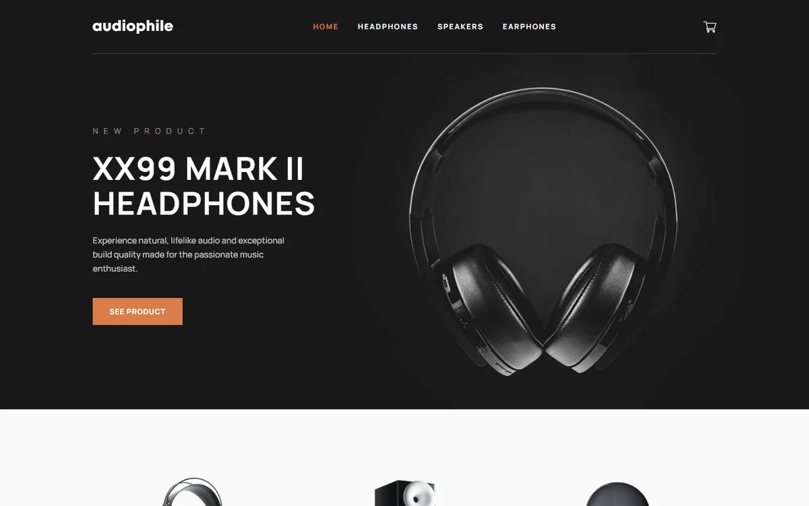

# Audiophile

A responsive audio shop demo with product browsing, a persistent cart, and a validated checkout journey.

[Live demo](https://audiophile-ui.vercel.app) · [Original challenge brief](docs/challenge-brief.md)



## Built with

React 19 · TypeScript · Vite · React Router · CSS Modules · Vitest · Playwright

## Features

- Three product categories, six product pages, responsive galleries, and recommendations.
- Cart additions, quantity updates, individual removal, empty states, and cross-tab persistence.
- Billing and shipping validation, with cash-on-delivery and demo e-Money form modes.
- Shipping, VAT, and grand-total calculations; confirmation dialog with expandable order summary.
- Keyboard-accessible dialogs, labelled errors, focus management, announcements, and responsive layouts.

## Implementation notes

`src/CartContext.tsx` owns cart state, `src/shop.ts` contains product and calculation helpers, and `src/Checkout.tsx` implements checkout validation and confirmation. `src/pages.tsx` provides the homepage, category listings, and product pages.

The cart persists under `audiophile-cart-v1` in `localStorage`. Malformed stored data is sanitized, and unavailable storage uses an in-memory fallback. Only product identifiers and quantities are saved; checkout personal and payment fields are not persisted.

Shipping is $50 for a nonempty cart. VAT is 20% of the product subtotal and is displayed as included; the grand total is the subtotal plus shipping. Quantities are capped at 99, and setting a quantity to zero removes the item.

## Run locally

Use Node.js 24 and npm. No application environment variables or external accounts are required.

```sh
npm ci
npm run dev -- --port 5317 --strictPort
```

Open `http://127.0.0.1:5317`.

```sh
npm run build
npm run preview -- --port 5318
```

Vercel deploys pushes to `main`. `vercel.json` sets the `dist/` output and route fallback for direct page visits.

## Verification

```sh
npm test
npm run build
npm run test:e2e
```

The deployment verification on 12 October 2026 passed TypeScript, the production build, and all 9 unit tests. Vitest covers cart transitions, sanitized persistence, totals, and checkout validation. Existing Playwright tests cover product routes, cart editing, persistence, form errors, payment modes, confirmation, keyboard behavior, missing images, and overflow at desktop, tablet, and mobile widths.

Playwright uses installed Google Chrome via `channel: "chrome"`; install Chrome or adjust that setting for your environment. Cross-browser and assistive-technology testing have not been performed.

## Demo scope and attribution

Checkout is a demonstration: **no payment is processed, order is submitted, or email is sent**. Use invented details when trying the form. There is no backend.

Challenge, design, product images, and icons: [Frontend Mentor](https://www.frontendmentor.io). Manrope is bundled through Fontsource under the SIL Open Font License. Premium design-file exclusions are retained. The screenshot shows the implemented app; `preview.jpg` retains the supplied reference. Full screen designs were not supplied, so exact matching against those absent designs cannot be verified.
